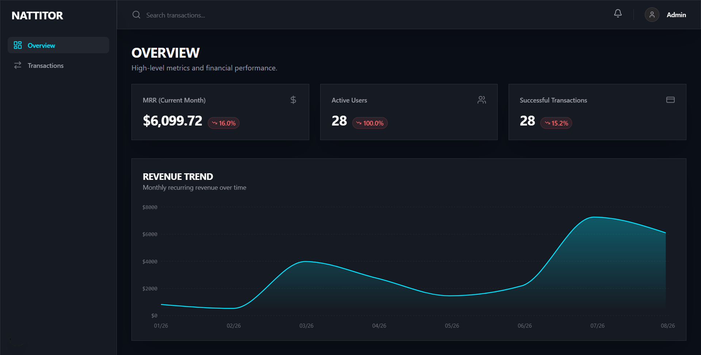

<p align="center">
  
</p>

# ✦ B2B Metrics Dashboard | Nattitor Portfolio

A high-performance, read-only B2B Analytics Dashboard engineered to visualize complex business metrics, user acquisition, and financial transactions.

Built with a focus on strict architectural standards, server-side data fetching, and a custom **"Dark Brutalist"** design system.

## ⚡ Tech Stack & Architecture

- **Framework:** [Next.js 15](https://nextjs.org/) (Strictly App Router & Server Components)
- **Styling:** [Tailwind CSS](https://tailwindcss.com/) + Custom utility functions (`clsx`, `tailwind-merge`)
- **Database:** [Supabase](https://supabase.com/) (PostgreSQL with relational schema)
- **Motion Physics:** [Framer Motion](https://www.framer.com/motion/) (Custom heavy spring configurations)
- **Data Visualization:** Recharts / Tremor
- **Icons:** Lucide React

## 🎯 Core Features

- **Server-Side Rendering (SSR):** Optimized data fetching directly from PostgreSQL, minimizing client-side JavaScript payloads.
- **Interactive Data Ledger:** A fully functional transactions table featuring server-side pagination, debounced searching, and dynamic column sorting.
- **Dynamic KPI Tracking:** Real-time data aggregation displaying Month-over-Month (MoM) growth metrics.
- **React Suspense Boundaries:** Custom brutalist skeleton loaders implemented across all async components to prevent hydration flickers and layout shifts.
- **Nattitor Design System:** Implements a strict visual language utilizing `JetBrains Mono` for data integrity, deep void backgrounds (`#0A0E17`), and tactile micro-interactions.

## 🚀 Getting Started

To run this project locally:

1. **Clone the repository:**
   ```bash
   git clone [https://github.com/tu-usuario/b2b-dashboard.git](https://github.com/tu-usuario/b2b-dashboard.git)
   cd b2b-dashboard
   ```
